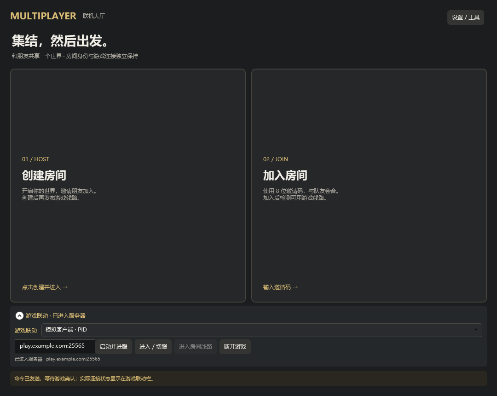

# Minecraft 客户端联机 Agent

## 使用

在新版启动器的 **联机房间 → 游戏联动** 展开区操作：

- 输入服务器域名/IP（可含端口），点击 **启动并进服**，使用“我的游戏”中选定的版本。IPv6 使用 `[地址]:端口`。
- 游戏已经由新版启动器启动时，在下拉框选择目标实例，点击 **进入 / 切服** 或 **断开游戏**。多个实例不会自动猜选。
- 加入房间后，先建立/检测线路或自动选择线路，再点击 **进入房间线路**。使用实际验证得到的本机接入地址，兼容房间原有 EasyTier/FRP 等传输；没有游戏进程时启动所选版本。
- 面板显示游戏实际采样的就绪、连接中、已进服、断开、不支持或错误状态。命令发送成功不等于连接成功。



Agent 随启动器内嵌，每次启动自动注入，无需复制到 mods。可以与 authlib-injector 并存，不接管登录认证。**之前已运行、未注入 Agent 的游戏需要重启**，不使用动态 attach。只支持 Minecraft Java 版。

房间身份和游戏连接保持独立：退出房间会按原逻辑清理房间传输，但不主动向游戏发送断开命令；本机传输消失可能导致游戏自然断线。游戏中断连接不自动退出房间。房间在线信息优先使用同一 PID 的 Agent 实时地址，断开后清空；只有无 Agent 的旧进程才保留原来的日志识别。

## 接入结构

`ModLaunch.McLaunchRun → GameLinkLaunch → GameLinkSession ↔ multiplayer-agent`

- 每个游戏进程一个 IPv4 loopback 临时监听端口、随机 256 位会话 token。token/映射路径通过环境变量传入，不写入 JVM 参数日志。
- Agent 只向本机发起连接，先认证再执行命令。帧长度上限 16 KiB；连接断开不自动操作游戏，不自动重连。
- CONNECT/DISCONNECT/状态采样在 Minecraft 主线程 Executor 执行；队列有界，超时取消尚未执行的命令。未知映射和签名明确报 unsupported，不猜测任意游戏方法。
- 游戏进程结束后清理会话。下载、提取或会话绑定失败不把已启动游戏误报为启动失败；运行时控制不可用时保留启动器原有能力。
- 不调用房间提供的程序/脚本。房间服务接口与认证机制不变，线路目标仍要求房间新鲜、线路启用、租约存活并已验证。

源代码：`tools/multiplayer-agent`、`PCL.Core/Minecraft/Launcher/GameLink*.cs`、`Modules/HybridUi/HybridRooms.GameLink.cs`。完整协议见 [Agent README](../tools/multiplayer-agent/README.md)。

## 版本与限制

目标为 **1.16.5 至当前版本的原版、Fabric/Quilt、Forge、NeoForge**，不是对任意客户端修改版的无条件保证。

适配 Mojang 官方 named/obf、Fabric intermediary 和 Forge SRG。启动器从 Mojang 官方版本元数据获取 `client_mappings`，从 Fabric 官方 Maven 获取 intermediary，从 Forge 官方 Maven 获取 MCPConfig，校验 SHA1、只解压指定映射条目，并在 `%LOCALAPPDATA%\MOONCL\game-link\mappings` 保存可校验的内容缓存。缓存存在时可离线使用；首次下载各分支有 20 秒上限并行执行，失败后尝试已知名称。

当前官方元数据返回 26.3（Java 25），无 `client_mappings`；它走 named 路径。只读校验其官方客户端 JAR 后，补充了 `Minecraft.disconnect(Screen,boolean)` 形状。1.16.5/1.21.1 官方签名及真实 Fabric/Forge 映射文件也已核对。

**尚未进行真实 Minecraft 的逐版本、逐加载器联机实测，不能宣称“所有客户端均验证通过”。** Java 8 classfile 兼容已检查；测试实际运行在 JDK 21，未实机运行 Java 8/25。非初始化单例读取使用 Unsafe 内部 API，被 JVM 禁止时明确报 unsupported。未来游戏签名变化或模组替换核心类也可能需要增加适配。

**单人存档和 LAN 房主一律拒绝自动切服/断开**，请先在游戏正常保存并退出。正在连接时须先在游戏手动取消，Agent 不会重入另一次连接。

## 构建与验证

需要 PowerShell 7、.NET 10 SDK、支持 `javac --release 8` 的 JDK（建议 JDK 21），以及原项目已恢复的 NuGet 依赖。启动器 MSBuild 会按源文件时间戳自动构建并内嵌 JAR。

```powershell
# 仓库 PCL-CY 根目录
.\scripts\Test-GameLink.ps1 -DotNetPath 'I:\dev\dotnet\dotnet.exe'
# 显式启用 Mojang/Fabric/Forge 实际下载检查
.\scripts\Test-GameLink.ps1 -DotNetPath 'I:\dev\dotnet\dotnet.exe' -CheckMappings
```

默认 JAR：`tools/multiplayer-agent/build/mooncl-multiplayer-agent.jar`。
Debug 启动器：`Plain Craft Launcher 2/bin/Debug/net10.0-windows/win-x64/Plain Craft Launcher 2.exe`。

本次结果：

| 检查 | 结果 |
| --- | --- |
| Java 编译/真实 premain 子 JVM/合成客户端 | 235 条断言通过；67 个 class 均 major 52 |
| 新增 .NET 通道/缓存/显式联网映射检查 | 6/6 通过 |
| WPF 联动面板（模拟 Agent、离屏窗口） | 31 项检查通过，含按钮发送/实际状态显示/禁用状态/实例标签 |
| 完整启动器 Debug 构建 | 通过，0 错误；原项目仍有大量警告 |
| 原房间网络测试 | 35 通过、3 跳过（未配置原生 EasyTier） |
| 核心全量测试（当时工作区） | 578 通过、50 失败、3 跳过；失败涉及原有缓存锁/数据、语言、元数据生命周期及网络等，不宣称全绿 |
| 完整房间 UI 冒烟 | 在原配置生命周期未初始化处失败；新增面板已由 `--game-link-only` 模式独立验证，未绕过失败将其报为全流程通过 |
| 独立审查服务 | 503，未取得审查报告；已自行检查并回归具体适配缺陷 |

报告与临时测试设置由脚本写入会话 scratch（无该变量时使用系统临时目录），不覆盖玩家设置。没有启动/关闭用户正在运行的启动器或游戏；工作区已有大量其他改动，未进行整库提交。
