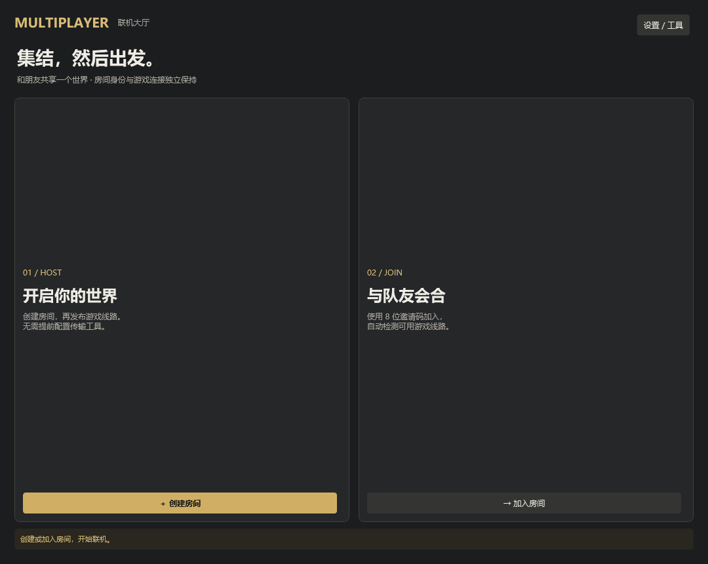
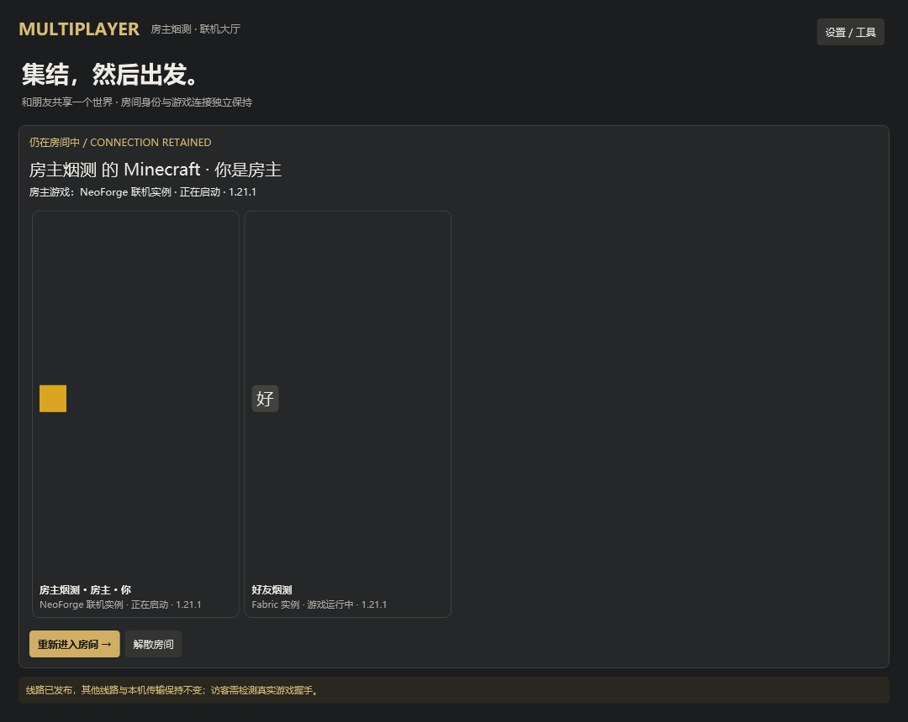
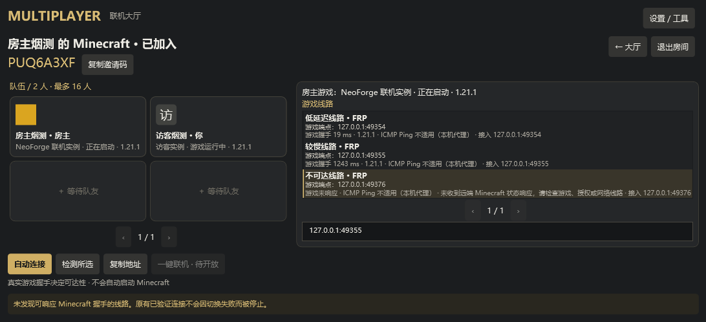
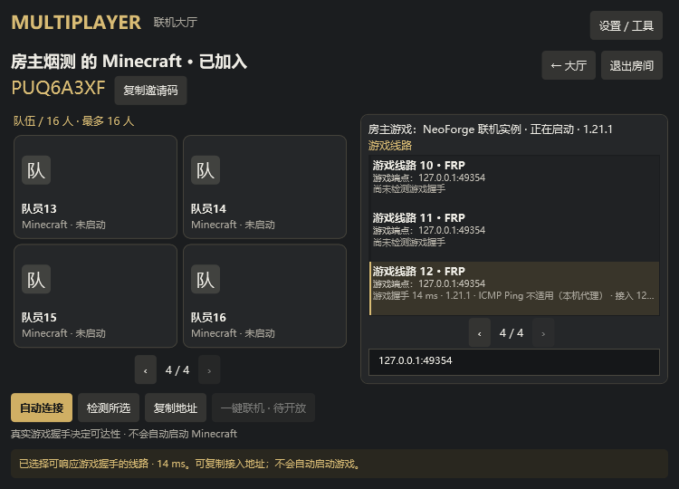
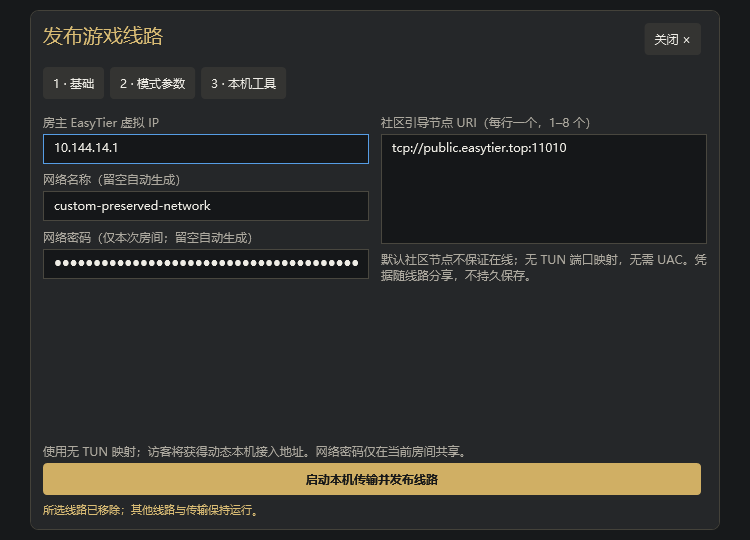

# 联机大厅、房间与多线路

## 中控产物在哪里

- 仓库内：`mooncl-cloud/build/libs/mooncl-cloud-1.0.0.jar`
- 当前工作区完整路径：`D:\pcl-cy\PCL-CY\mooncl-cloud\build\libs\mooncl-cloud-1.0.0.jar`
- 构建：在 `mooncl-cloud` 运行 `./gradlew bootJar`，构建需要 JDK 17 或更高版本，生成的 JAR 支持 Java 17+（class 61）。协议和反向代理配置见 [中控接口](../mooncl-cloud/docs/rooms.md)。

此 JAR 已包含房间 v2 API，不需要额外数据库、Redis 或消息队列。房间为有界内存状态，重启清空；请部署单实例。中控只交换成员、游戏状态和线路配置，**不转发游戏流量**，也不是 frps、ZeroTier 控制器或 EasyTier 引导节点。

当前发布配置的官方节点使用临时端口 **6664**，实际地址集中在 `PCL.Core/Multiplayer/RoomServiceDirectory.cs`，不出现在玩家界面、普通设置或错误消息中。隐藏界面地址不是网络层保密措施；生产环境应给官方节点配置域名和 HTTPS，并更新该发布配置。当前节点尚未由本次工作部署。

最小 Windows 启动示例（在 JAR 所在目录运行）：

```powershell
$env:MOONCL_PUBLIC_PORT = '6664'
$env:MOONCL_ADMIN_PORT = '6665'
$env:MOONCL_ADMIN_BIND = '127.0.0.1'
$env:MOONCL_ADMIN_TOKEN = [Convert]::ToHexString([Security.Cryptography.RandomNumberGenerator]::GetBytes(24))
$env:MOONCL_DATA_DIR = '.\data'
java -Xms32m -Xmx128m -jar .\mooncl-cloud-1.0.0.jar
```

生产环境请安全持久保存环境变量；不要把管理令牌发给玩家。管理端口只绑定回环，不要对公网开放。房间 API 在获取端口上；TLS 反向代理必须保留 Authorization，禁止缓存及记录房间请求/响应正文。默认示例代理仅适用于整合包目录，需按中控协议文档增加房间路由，写请求上限 32 KiB。

## 玩家流程

1. 左侧进入 **联机房间**，大厅默认选择 **官方中控**，没有地址输入要求。下拉切换 **自定义中控** 后才显示地址框；自定义须用 HTTPS，本机调试可以使用回环 HTTP。临时官方节点为 HTTP 时会明确提醒明文风险，不伪造在线状态。
2. **创建房间 / 加入房间** 只需要名称、邀请码和可选密码，不要求先配置网络工具。成功后进入房间。
3. 房间展示房主的实例名称、Minecraft 版本及未启动 / 正在启动 / 运行中 / 启动失败状态，以及其他成员的名称、头像和游戏状态。状态来自实际启动任务和游戏进程观察，不把“选中了实例”当作游戏已运行。
4. 房主在房间内添加线路，可以同时发布 IPv6、FRP、XTCP、ZeroTier、EasyTier 等不同线路，最多 12 条。移除一条线路只停止它对应的本机资源，其他线路继续工作。
5. 访客可以 **自动选择** 全部启用线路中游戏握手延迟最低的一条，或 **建立 / 检测所选线路**。列表同时展示游戏握手延迟、ICMP Ping 和接入地址。Ping 无响应不等于游戏不可达；本机代理的 Ping 不当作远端延迟。
6. 切换线路失败会保留之前可用的连接。**返回大厅** 不退出房间、不停止连接，大厅显示当前房间和重新进入入口。只有明确退出 / 解散、房间身份失效或关闭启动器才回收本轮拥有的资源。

本阶段仍不会自动启动 Minecraft 或自动进入服务器；一键联机按钮明确禁用。请自行启动世界并开放到局域网，线路向导会尝试读取运行中游戏日志中的 LAN 端口，未检测到时可手动填写。版本/模组兼容检查留给后续阶段。

### 固定布局游戏大厅

- 大厅只保留创建 / 加入两个入口和当前房间入口；身份、中控与工具集中在设置面板。
- 房间采用玩家席位、房主游戏状态、线路侧栏和底部连接操作的固定布局，不显示页面滚动条。
- 玩家每页 4 人（最多 16 人），线路每页 3 条（最多 12 条）；使用翻页访问，不靠滚动或缩小整页。翻页、打开设置和返回大厅都不会退出房间或中断心跳。
- 线路配置采用“基础 → 模式参数 → 本机工具”面板；工具按 FRP/P2P、EasyTier、ZeroTier 分组。按 Esc 关闭面板并返回原操作位置。

### 少填表的自动建议

- 房间名称根据玩家和所选实例建议，线路名称按连接模式建议；手动改名后不会被自动覆盖。
- 打开 IPv6 参数时读取本机公网 IPv6；可手动覆盖。没有 IPv6 时不会伪造地址或修改防火墙。
- 打开线路向导时，尝试从运行中实例的 `logs/latest.log` 有界读取已开放的 LAN 端口；明确的停服日志会使旧端口失效。未开放 LAN 或日志格式无法识别时，仍需手动填写。
- 在启动器、Binary、tools 及项目既有 EasyTier 安装目录查找已存在的工具，不递归扫描磁盘、不静默下载、不从房间传入的路径运行程序；发现路径不等于来源可信，启动前仍需确认。
- EasyTier 网络名称和随机密码可留空，在发布前生成；密码只留本次会话，不写入普通设置。
- FRP 控制节点、Token 和节点分配的远程端口不能可靠推断，仍需提供；ZeroTier Network ID 与控制台授权也不会自动申请。已加入网络的地址可只读获取，既有网络退出保护不变。











## 现成网络适配

| 方式 | 本机依赖 | 游戏数据路径 / 注意事项 |
|---|---|---|
| IPv6 | 系统 TCP/IPv6 | 访客直连房主；双方须有公网 IPv6，房主手动放行游戏端口 |
| FRP TCP | 房主使用官方 frpc 0.61+，自备 frps 节点和远程端口 | 游戏数据经过 frps；访客不需要 frpc，控制端口与远程游戏端口分开配置 |
| P2P / XTCP | 双方使用 frpc、同一 frps 的本机登录凭据 | 复用 frp 打洞；代理名与房间访客密钥随机生成，登录 token 不随房间分享；NAT 不支持时可通过其他已发布线路连接 |
| ZeroTier | 已安装并启动的 ZeroTier One 服务 | 使用本机 9993 API，网络控制器须授权设备；不会导入默认路由、全局路由或 DNS，不卸载服务 |
| EasyTier | 可信 easytier-core 2.6.4 | 复用现有 GameLink 的 `--no-tun`、smoltcp 和回环 TCP 转发，无需新增 Wintun/UAC；引导节点自备或使用明示的社区节点，不保证在线 |

参考 `I:\CYPlay` 的服务生命周期和状态处理；EasyTier 采用当前项目既有的免 TUN 转发，而非复制 CYPlay 的全局虚拟网卡实例。每条 EasyTier 线路有独立 RPC 端口，访客接入仅监听 `127.0.0.1`。本次真实双进程回归发现 Windows 强制物理设备绑定会导致本机对等连接 `10049 / AddrNotAvailable`，因此显式使用 `--bind-device false`，由系统选择源地址。组网尚未就绪时有界重试，不把等待时间计入握手延迟。

- frpc 先执行 `verify -c` 再启动。EasyTier 使用原生参数和环境变量；其网络密码不放入命令行。只运行用户选择的可信本机程序，不执行房间提供的路径或脚本。
- frpc / EasyTier 进程由独立 Windows 作业对象管理，只关闭本轮子进程；不按程序名杀进程。多条 ZeroTier 线路共享网络引用，已有用户网络不会因本轮退出而被移除。系统服务被强制终止时无法保证执行 ZeroTier leave，需在系统客户端中检查遗留成员状态。
- ZeroTier Token 在本机密码框提供，或从 ProgramData 默认文件读取；只放在本机 API 请求头，不放进 URL、中控或日志。权限不足时提示用户配置，不静默提权。
- 非敏感设置在 `%LOCALAPPDATA%\MOONCL\multiplayer.json`，仅保存自定义中控选择、地址及工具路径等。房间密码、成员令牌、frps Token、ZeroTier Token、EasyTier 密码不写入普通设置。
- 头像是有界小 PNG（最大 64×64，解码字节不超过 6144），不加载成员提供的远程图片地址；无头像时显示姓名首字。头像缓存有界，心跳不重复编码不变的头像。
- 心跳独立于线路探测，正常每 15 秒一次，头像/游戏状态变化约 3 秒后更新；中控租约 75 秒。启动器关闭时尽力发送退出，异常结束依靠租约清理中控状态。
- FRP 公网端口仍需依靠 Minecraft 正版验证、白名单等保护；邀请码和房间密码不能替代游戏服务器认证。只加入可信好友的房间和虚拟网络。

## 测试与后续接口

```powershell
# 独立网络模块：不会启动主窗口或编译无关业务。
dotnet test .\scripts\room-tests\Room.Network.Test.csproj

# 启用真实 EasyTier 原生启动/端到端测试；程序路径由开发者明确提供。
$env:MOONCL_TEST_EASYTIER_CORE = 'C:\tools\easytier\easytier-core.exe'
dotnet test .\scripts\room-tests\Room.Network.Test.csproj

# 完整 WPF + 隔离 Java 中控 + 游戏协议模拟端点，需先构建 bootJar。
.\scripts\Test-Rooms.ps1 -DotNetPath 'C:\path\to\sdk\dotnet.exe'
```

页面检查使用独立设置目录、随机端口、随机测试房间，且只允许回环中控，结束后关闭自有测试进程，不覆盖玩家设置。`-ScreenshotDirectory` 可保存截图，默认写入临时目录；无原生 EasyTier 路径时，两项原生测试会显式跳过而不是假通过。

`RoomSession.PublishRoutesAsync` 发布完整线路集合，旧的 `PublishConnectionAsync` 仍兼容单线路；`RoomSession.RefreshAsync(presence)` 更新本人成员资料。`HybridRooms.GetLaunchTarget()` 返回当前有效且通过检测的连接目标，供后续一键启动集成使用，但本身不启动游戏。

已完成本机中控、WPF 流程和 EasyTier 真正端到端检查。跨公网 IPv6、FRP、XTCP 与真实 ZeroTier 控制器授权仍需部署节点及双机验证，不承诺所有 NAT 都能穿透。
