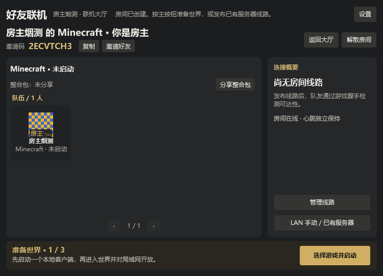

# 联机大厅、房间与多线路

## 中控产物在哪里

- 仓库内：`mooncl-cloud/build/libs/mooncl-cloud-1.0.0.jar`
- 当前工作区完整路径：`D:\pcl-cy\PCL-CY\mooncl-cloud\build\libs\mooncl-cloud-1.0.0.jar`
- 构建：在 `mooncl-cloud` 运行 `./gradlew bootJar`，构建需要 JDK 17 或更高版本，生成的 JAR 支持 Java 17+（class 61）。协议和反向代理配置见 [中控接口](../mooncl-cloud/docs/rooms.md)。

此 JAR 已包含房间 v2 API，不需要额外数据库、Redis 或消息队列。房间为有界内存状态，重启清空；请部署单实例。中控只交换成员、游戏状态和线路配置，**不转发游戏流量**，也不是 frps、ZeroTier 控制器或 EasyTier 引导节点。

当前发布配置的官方节点使用临时端口 **6664**，实际地址集中在 `PCL.Core/Multiplayer/RoomServiceDirectory.cs`，不出现在玩家界面、普通设置或错误消息中。隐藏界面地址不是网络层保密措施；生产环境应给官方节点配置域名和 HTTPS，并更新该发布配置。当前节点尚未由本次工作部署。

最小 Windows 启动示例（在 JAR 所在目录运行）：

```powershell
$env:MOONCL_PUBLIC_PORT = '6664'
$env:MOONCL_ADMIN_PORT = '6665'
$env:MOONCL_ADMIN_BIND = '127.0.0.1'
$env:MOONCL_ADMIN_TOKEN = [Convert]::ToHexString([Security.Cryptography.RandomNumberGenerator]::GetBytes(24))
$env:MOONCL_DATA_DIR = '.\data'
java -Xms32m -Xmx128m -jar .\mooncl-cloud-1.0.0.jar
```

生产环境请安全持久保存环境变量；不要把管理令牌发给玩家。管理端口只绑定回环，不要对公网开放。房间 API 在获取端口上；TLS 反向代理必须保留 Authorization，禁止缓存及记录房间请求/响应正文。默认示例代理仅适用于整合包目录，需按中控协议文档增加房间路由，写请求上限 32 KiB。

## 玩家流程（好友组队房间）

1. 大厅选择 **创建房间**，确认自动建议的名称和可选密码后建房；或输入 8 位邀请码加入。默认官方中控，自定义中控和身份放在设置中。创建和加入不要求先配置穿透工具，也不表示游戏已经连通。
2. 房间顶部放名称、邀请码、复制和好友邀请；左侧是当前游戏、整合包与队友，右侧只放连接概要及管理入口。底部只有一个主要操作，根据房主/访客及真实状态显示下一步。
3. **房主准备世界**：选择本地游戏启动 → 在游戏内进入世界并“对局域网开放” → 检测日志中的 LAN 端口并发布线路。启动器不会伪称自动开放 LAN；无法识别端口时可以手填。已有服务器通过“LAN 手动 / 已有服务器”进入线路向导，不必先启动本地世界。
4. **访客连接并进入**：点主按钮检测启用线路，默认选择 Minecraft 握手延迟最低的线路，然后确认本地客户端。已有同版本且可控的游戏直接进服，否则启动所选同版本客户端。加载中、不可控或无法确定版本的游戏不被当成“没有运行”，避免重复启动。相同 Minecraft 版本不代表模组兼容，请和房主确认整合包及配置。
5. 默认目标始终优先使用房间线路。只有没有房间线路且房主分享了服务器时，主按钮才引导进入该服务器。队友席位的“跟随队友”是玩家主动选择的另一个目标，不会自动抢占默认目标。已在其他服务器的客户端切服前会确认，不静默切服。
6. **管理线路**保留 IPv6、自定义 IP、FRP、P2P、ZeroTier、EasyTier 与最多 12 条线路。自动检测切回自动选路；“检测所选”锁定手动线路。检测只验证传输，不启动游戏；复制地址和高级手动游戏控制也在此面板。游戏握手和 ICMP Ping 分开显示，本机代理 Ping 不冒充远端延迟。
7. **房间身份、线路可达与游戏进服是三种状态**。发送指令或请求启动只显示进行中，实际对应游戏会话确认目标地址及请求后才显示已进服；超时、Agent 不支持、断开和错误有手动加入/重试提示。取消不会强杀已启动游戏。主流程失败或取消会回收本轮新线路并恢复之前可用线路；手动换线检测失败也保留原连接。切换传输可能需要重新进服，不承诺无缝迁移。
8. **返回大厅**和切到其他页面不会退出房间或中断心跳；大厅显示当前房间摘要。退出/解散有确认，可取消保留房间；明确退出后回收本房间拥有的传输，不强杀游戏，不影响无关工具进程。房间心跳异常不直接认定游戏断线。
9. 整合包分享/下载放在游戏摘要旁，仍只分享公开下载地址，不上传实例文件或本机路径。安装继续使用启动器既有流程，不自动串联安装后启动。无同版本客户端时先安装或手动加入，不随意选择不兼容版本。

### 布局与操作

- WPF 原生炭黑＋暖金：中文标题、统一文字层级，金色突出主操作，绿色表示游戏确认进服，暖色表示未完成；技术参数不常驻普通房间。
- 主页面固定布局，不用滚动或整体缩放塞内容。750×540 紧凑视口和较大窗口均保留主操作、邀请与管理入口。
- 玩家每页 8 人、4 列×2 行，最多 16 人；头像 48px 最近邻等比显示，不铺满空席。线路在管理面板每页 3 条，最多 12 条；高级控制展开后允许面板内部滚动，不挤压主页面。
- 设置、线路配置、游戏选择及退出确认使用互斥面板；Esc 关闭并恢复焦点，关闭游戏选择等同取消本次操作。分页和面板导航不重置房间心跳。

### 少填表的自动建议

- 房间和线路名称自动建议，手动修改后保留。
- IPv6 读取本机公网地址，不伪造 IPv6，不自动改防火墙。
- LAN 从运行中实例 `logs/latest.log` 有界读取；明确停服后旧端口失效；未检测到仍可手填。
- 只在启动器既有目录寻找本机工具，不递归扫盘、不静默下载或执行房间传入的路径。
- EasyTier 网络名与随机密码在发布前生成，仅本次会话保存；FRP 节点与凭据、ZeroTier 网络 ID 和授权仍需用户提供。



[大厅](images/multiplayer-hall-redesign.png) · [满员紧凑房间](images/multiplayer-room-redesign-full.png) · [游戏确认进服](images/multiplayer-flow-redesign.png)。截图均为隔离测试数据。

## 现成网络适配

| 方式 | 本机依赖 | 游戏数据路径 / 注意事项 |
|---|---|---|
| IPv6 | 系统 TCP/IPv6 | 访客直连房主；双方须有公网 IPv6，房主手动放行游戏端口 |
| FRP TCP | 房主使用官方 frpc 0.61+，自备 frps 节点和远程端口 | 游戏数据经过 frps；访客不需要 frpc，控制端口与远程游戏端口分开配置 |
| P2P / XTCP | 双方使用 frpc、同一 frps 的本机登录凭据 | 复用 frp 打洞；代理名与房间访客密钥随机生成，登录 token 不随房间分享；NAT 不支持时可通过其他已发布线路连接 |
| ZeroTier | 已安装并启动的 ZeroTier One 服务 | 使用本机 9993 API，网络控制器须授权设备；不会导入默认路由、全局路由或 DNS，不卸载服务 |
| EasyTier | 可信 easytier-core 2.6.4 | 复用现有 GameLink 的 `--no-tun`、smoltcp 和回环 TCP 转发，无需新增 Wintun/UAC；引导节点自备或使用明示的社区节点，不保证在线 |

参考 `I:\CYPlay` 的服务生命周期和状态处理；EasyTier 采用当前项目既有的免 TUN 转发，而非复制 CYPlay 的全局虚拟网卡实例。每条 EasyTier 线路有独立 RPC 端口，访客接入仅监听 `127.0.0.1`。本次真实双进程回归发现 Windows 强制物理设备绑定会导致本机对等连接 `10049 / AddrNotAvailable`，因此显式使用 `--bind-device false`，由系统选择源地址。组网尚未就绪时有界重试，不把等待时间计入握手延迟。

- frpc 先执行 `verify -c` 再启动。EasyTier 使用原生参数和环境变量；其网络密码不放入命令行。只运行用户选择的可信本机程序，不执行房间提供的路径或脚本。
- 房间底部“工具”可直达工具面板。EasyTier 分组支持选择程序、检测版本和获取工具；“获取”经确认后复用启动器现有下载任务与下载源，任务区可取消，完成后回填路径，不自动加入网络。已有下载任务会复用，下载期间手动修改的路径不会被覆盖。工具版本检测限制输出与超时时间，只查询本机 Core，不启动组网实例。推荐 2.6.4；本轮已实测本机版本查询和真实端到端转发，未进行外网下载实测。
- frpc / EasyTier 进程由独立 Windows 作业对象管理，只关闭本轮子进程；不按程序名杀进程。多条 ZeroTier 线路共享网络引用，已有用户网络不会因本轮退出而被移除。系统服务被强制终止时无法保证执行 ZeroTier leave，需在系统客户端中检查遗留成员状态。
- ZeroTier Token 在本机密码框提供，或从 ProgramData 默认文件读取；只放在本机 API 请求头，不放进 URL、中控或日志。权限不足时提示用户配置，不静默提权。
- 非敏感设置在 `%LOCALAPPDATA%\MOONCL\multiplayer.json`，仅保存自定义中控选择、地址及工具路径等。房间密码、成员令牌、frps Token、ZeroTier Token、EasyTier 密码不写入普通设置。
- 头像是有界小 PNG（最大 64×64，解码字节不超过 6144），皮肤源像素采用最近邻取样，透明帽子层使用预乘透明度合成；显示端等比例最近邻放大，避免先模糊缩放再放大的问题。不加载成员提供的远程图片地址，无头像时显示姓名首字。头像缓存有界，心跳不重复编码不变的头像。
- 心跳独立于线路探测，正常每 15 秒一次，头像/游戏状态变化约 3 秒后更新；中控租约 75 秒。启动器关闭时尽力发送退出，异常结束依靠租约清理中控状态。
- FRP 公网端口仍需依靠 Minecraft 正版验证、白名单等保护；邀请码和房间密码不能替代游戏服务器认证。只加入可信好友的房间和虚拟网络。

## 测试与后续接口

```powershell
# 独立网络模块：不会启动主窗口或编译无关业务。
dotnet test .\scripts\room-tests\Room.Network.Test.csproj

# 启用真实 EasyTier 原生启动/端到端测试；程序路径由开发者明确提供。
$env:MOONCL_TEST_EASYTIER_CORE = 'C:\tools\easytier\easytier-core.exe'
dotnet test .\scripts\room-tests\Room.Network.Test.csproj

# 完整 WPF + 隔离 Java 中控 + 游戏协议模拟端点，需先构建 bootJar。
.\scripts\Test-Rooms.ps1 -DotNetPath 'C:\path\to\sdk\dotnet.exe'
```

页面检查使用独立设置目录、随机端口、随机测试房间，且只允许回环中控，结束后关闭自有测试进程，不覆盖玩家设置。`-ScreenshotDirectory` 可保存截图，默认写入临时目录；无原生 EasyTier 路径时，三项原生测试会显式跳过而不是假通过。

`RoomSession.PublishRoutesAsync` 发布完整线路集合，旧的 `PublishConnectionAsync` 仍兼容单线路；`RoomSession.RefreshAsync(presence)` 更新本人成员资料。`HybridRooms.GetLaunchTarget()` 返回当前有效且通过检测的连接目标，本身不启动游戏；统一主按钮在确认目标和用户选择后复用既有启动器或 GameLink 控制。状态决策集中于 `RoomFlowPresentation`，流程与取消/回退集中于 `HybridRooms.Flow.cs`。

本轮重设计验证：Debug/x64 主工程构建成功（0 错误）；独立房间测试 39 通过、3 项原生 EasyTier 测试因未指定程序而跳过；WPF + 隔离回环 Java 中控 + 模拟游戏/Agent 的 557 项检查通过。覆盖创建确认、退出取消、750×540/大窗口、16 人与 12 线路分页、独立心跳、自动/手动线路、失败保留连接、主按钮进服、请求关联、旧回调、取消回退、超时和不可控提示。满员场景按真实中控限流等待窗口，不放宽生产限流。

本轮未执行真实 Minecraft 启动/进服、真实账号登录、跨公网双机联机及原生 EasyTier 端到端；既有版本曾有本机 EasyTier 转发验证，不代表本轮复测。跨公网 IPv6、FRP、XTCP 与真实 ZeroTier 授权仍需部署节点及双机验证，不承诺所有 NAT 都能穿透。
