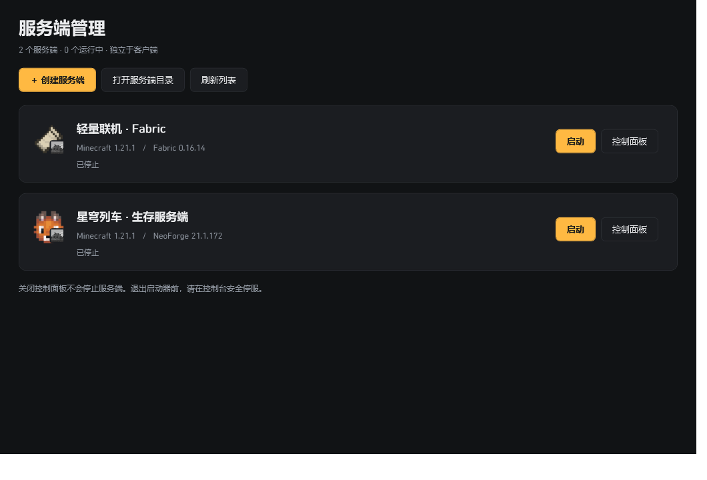
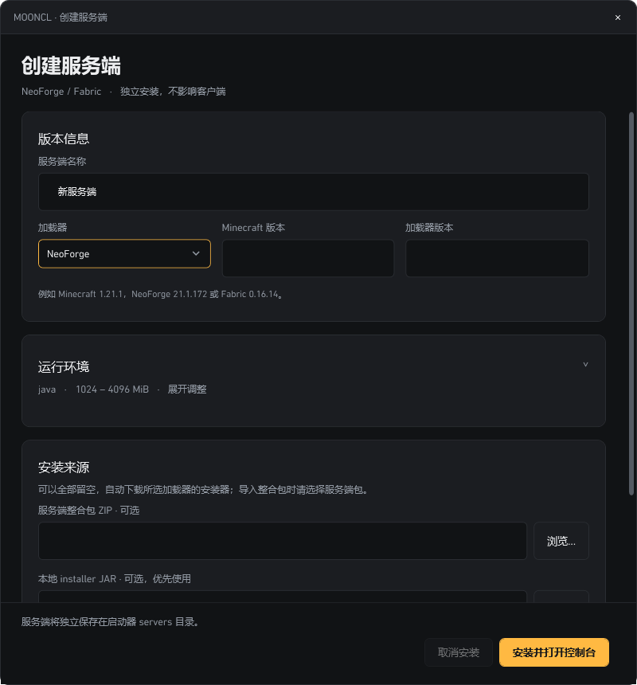

# 服务端管理

## 入口和数据隔离

进入版本列表，点击「切换至服务端管理列表」。客户端仍使用原来的版本列表和启动流程；服务端保存于启动器目录下的 `servers/<id>/`，不会写入客户端 `versions`、模组目录、账号或客户端 Java 设置。

列表图标使用所选 NeoForge / Fabric 的原有加载器图标，右下角叠加服务器图标。每个服务端有独立控制面板，重复打开会激活现有窗口。关闭面板不会停止进程，正常退出启动器前必须停止服务端并完成或取消安装。

## 安装

1. 点击「创建服务端」，填写名称、加载器、精确的 Minecraft 和加载器版本；展开「运行环境」可调整独立的 Java 和内存。
2. 可选择服务端 ZIP 整合包和本地加载器 installer JAR。不选 JAR 时使用对应官方 Maven 的安装器；不是客户端自动安装器。
3. NeoForge 使用 `java -jar installer.jar --installServer`；Fabric 使用 `java -jar installer.jar server -mcversion <版本> -loader <版本> -downloadMinecraft`。
4. 需要整合包自己的安装流程时，选择其 `.bat` / `.cmd` / `.ps1` 脚本。执行脚本必须明确勾选信任。安装器和脚本拥有当前用户权限，不应选择不可信来源。
5. 点击「安装并打开控制台」，在独立控制面板查看日志。安装按钮和状态固定在窗口底部。安装窗口可以取消；失败实例保留，可通过「重试安装」检查后重试。只有安装成功并检测到有效启动入口才可启动。

客户端 CurseForge / Modrinth 清单并不等于服务端包，不能自动保证客户端模组在服务端可用。请选择整合包作者提供的服务端 ZIP。需要交互输入的脚本应先改成无交互流程。客户端整包下载目录和在线整合包目录不与服务端混用。

## 启动和控制

首次启动需要用户阅读并明确接受 [Minecraft EULA](https://aka.ms/MinecraftEULA)，才会写入 `eula=true`。

控制面板支持实时 stdout/stderr、命令输入、`stop` 安全停止和明确确认后的强制结束。强制结束可能损坏存档，应优先安全停止。控制台日志为内存中的有界记录；游戏自己的完整日志仍在服务端 `logs` 目录。

版本设置可修改独立的 Java 路径、内存、额外 JVM 参数和启动入口。NeoForge 自动识别 `libraries/net/neoforged/neoforge/**/win_args.txt`；Fabric 自动识别 `fabric-server-launch.jar`。自定义脚本入口的内存/JVM 参数由脚本自行管理。更换加载器或游戏版本请新建服务端，避免把旧世界和库文件混在一起。

## server.properties

「常用配置」提供 MOTD、绑定地址、端口、人数、正版验证、白名单、游戏模式、难度、PvP、飞行、命令方块、视距、模拟距离、世界名称和种子、RCON 开关。「全部属性 / 高级」编辑现有属性，也可添加属性。

保存保留未知配置项和注释。端口、人数等输入会校验，禁止换行注入。若文件被服务端或其他工具修改，界面要求重新读取，防止旧表单覆盖新配置。运行和安装期间禁止修改配置；保存后下次启动生效。种子只影响新生成的世界，不会重建已有世界。

本功能不自动开放防火墙、配置端口映射或创建公网入口。关闭正版验证、启用 RCON 等安全相关选项应由服主管理。

## 界面示例

以下为隔离测试数据的原生 WPF 截图，不代表真实 Minecraft 服务端正在运行。服务端区域复用启动器 Hybrid 主题的背景、表面、文字、边框与暖金强调色；独立窗口和下拉菜单也使用同一套资源，样式仅在服务端区域生效。





## 开发验证

```powershell
dotnet build '.\Plain Craft Launcher 2\Plain Craft Launcher 2.csproj' -c Debug -p:Platform=x64
dotnet test '.\PCL.Core.Test\PCL.Core.Test.csproj' -c Debug -p:Platform=x64 --filter 'FullyQualifiedName~ServerManagementTest'
dotnet run --project '.\scripts\ui-smoke\VersionListEvents.csproj' -- '.\Plain Craft Launcher 2\bin\Debug\net10.0-windows\win-x64\Plain Craft Launcher 2.dll' --page --server-theme
```

专项测试无需下载 Minecraft 或联网，使用隔离目录、假服务端 ZIP 和真实的模拟脚本进程，覆盖加载器参数、下载源顺序、属性转义、路径隔离、EULA 门槛、安装成功/失败/取消、重复启动、命令输入、停止/重启及配置快照。真实整合包的模组兼容性仍需服主在对应包上验证。

版本页检查针对实际编译程序集，验证自定义 `MyButton.Click` 的运行时委托绑定、`PageSelectRight` 的 BAML 加载及客户端/服务端列表往返切换。宿主只使用内存默认配置，不启动完整启动器生命周期；因此既能捕捉编译通过但 XAML 事件签名不兼容的问题，也不会读取用户配置或启动游戏。

主题检查同时验证深色主题、浅色资源替换、可见文字对比度、下拉菜单、高级折叠项，以及窄窗口下底部安装按钮未被裁切。浅色替换仅用于测试动态资源适配，不改变启动器默认主题。测试服务端实例在检查结束后清理。
